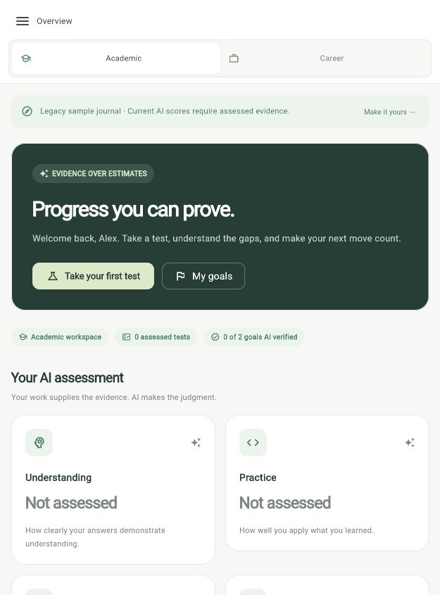
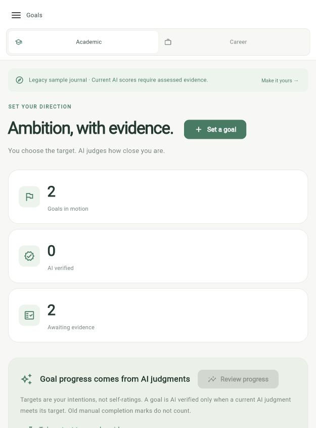
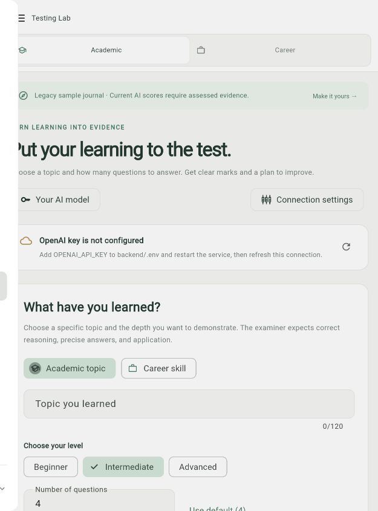

<p align="center">
  
</p>

<h1 align="center">Progress Meter</h1>

<p align="center">
  Evidence-first academic and career growth tracking for students.<br />
  Test what you know, set ambitious targets, and let AI judge progress from evidence.
</p>

<p align="center">
  <a href="https://progress-meter-kappa.vercel.app/">Open the web app</a>
  ·
  <a href="apps/progress_meter/README.md">Read the app guide</a>
  ·
  <a href="apps/progress_meter/docs/ARCHITECTURE.md">Explore the architecture</a>
</p>

<p align="center">
  
  
  
</p>

The student Progress Meter Flutter application is in **[`apps/progress_meter/`](apps/progress_meter/)**. Version 1.8.0 includes academic and career progress, AI-only assessments, Testing Lab, goals, researched benchmark paths, routines, daily tasks, document imports, and personal AI provider connections.

## Mobile app preview

The gallery below shows the responsive app layout at a mobile-sized viewport—the same navigation and cards used on iPhone. Select any image to open the full-resolution preview.

<table>
  <tr>
    <td align="center" width="33%">
      <a href="docs/screenshots/overview-mobile.jpg">
        
      </a><br />
      <sub><b>Overview</b><br />AI assessment snapshot</sub>
    </td>
    <td align="center" width="33%">
      <a href="docs/screenshots/goals-mobile.jpg">
        
      </a><br />
      <sub><b>Goals</b><br />AI-verified direction</sub>
    </td>
    <td align="center" width="33%">
      <a href="docs/screenshots/testing-lab-mobile.jpg">
        
      </a><br />
      <sub><b>Testing Lab</b><br />Hard questions and feedback</sub>
    </td>
  </tr>
</table>

## What it helps you do

| Focus | Built for |
| --- | --- |
| **Measure** | AI-only judgments for understanding, practice, consistency, and outcomes |
| **Improve** | Strict Testing Lab exams with custom question counts and actionable feedback |
| **Aim higher** | Research benchmark paths, set targets, and track readiness against evidence |
| **Stay consistent** | Routines, daily tasks, classes, food plans, reminders, and history |

This repository contains the Flutter app and its optional AI gateway. The older NestJS service that previously lived at the repository root has been removed from the current tree; its earlier commits remain in Git history if it ever needs to be recovered. The Flutter app uses local device storage, direct personal AI connections, or the gateway in `apps/progress_meter/backend/`.

## Run the Flutter app

Use Flutter with Dart 3.13 or newer within Dart 3.x. macOS development also requires Xcode and CocoaPods.

```sh
cd apps/progress_meter
flutter pub get
flutter run -d macos
```

For iPhone setup, feature details, and current platform limits, see the [app README](apps/progress_meter/README.md). Android runner files are included; Android device behavior has not been verified.

## Web version

Open the deployed browser version at [progress-meter-kappa.vercel.app](https://progress-meter-kappa.vercel.app/). It keeps browser-local workspace data and supports the core dashboard, goals, routines, tasks, benchmarks, and evidence flows. For AI requests, configure a reachable HTTPS gateway in the app; native notifications and local file integrations remain available in the macOS/iOS builds.

The app also includes a small standalone C helper under [`apps/progress_meter/native/`](apps/progress_meter/native/). It calculates deterministic benchmark roadmap readiness from milestone completion fractions and has a C ABI suitable for future Dart FFI integration. It does not judge the four AI-only progress dimensions. Run `make test` in that directory to verify it.

## Configure AI

In the app, open **Settings → Your AI model → Connect my AI** and select your provider, model ID, and API key. Personal keys stay in memory for the current app session and are excluded from saved data and backups.

To use the app's optional Node.js AI gateway instead, follow its [backend setup instructions](apps/progress_meter/backend/README.md). Create `apps/progress_meter/backend/.env` from `apps/progress_meter/backend/.env.example`; API keys and local environment files are excluded from version control.

## Verify the app

```sh
cd apps/progress_meter
flutter analyze
flutter test
cd backend
npm test
```

The 1.8.0 release passed 233 Flutter tests and 53 AI gateway tests, plus a live OpenAI check with synthetic data. See the [architecture notes](apps/progress_meter/docs/ARCHITECTURE.md) for implementation details.
